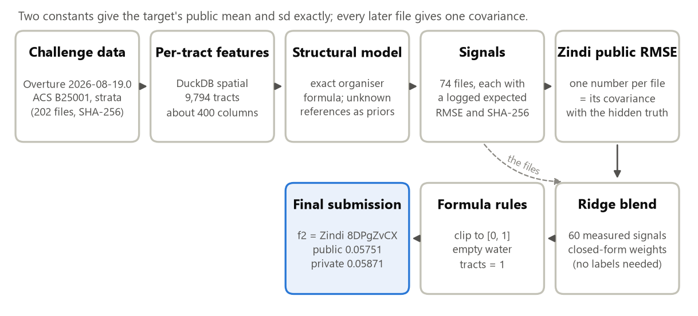
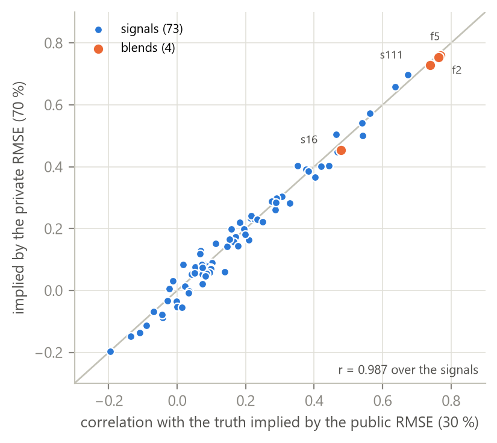
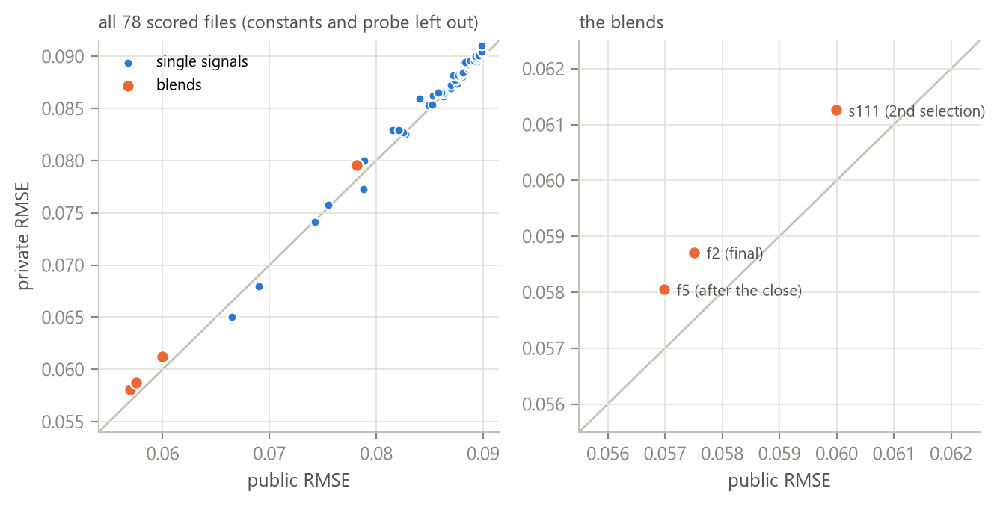
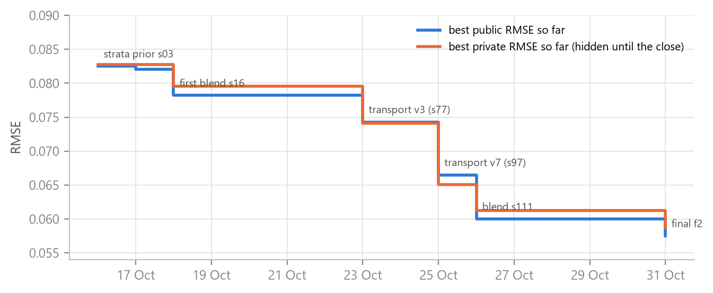
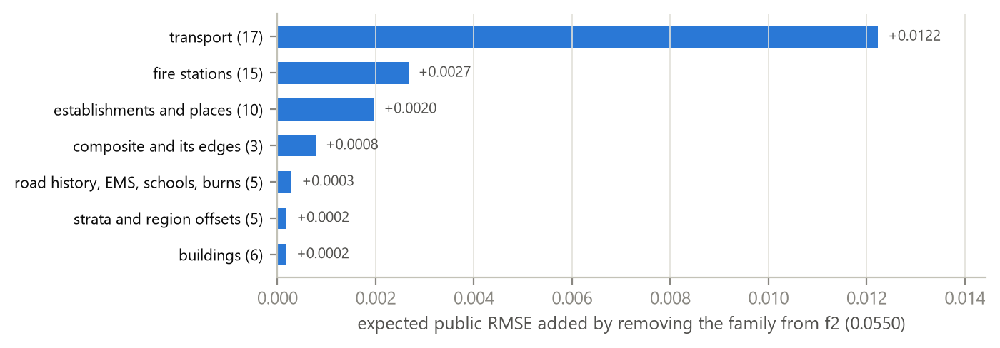
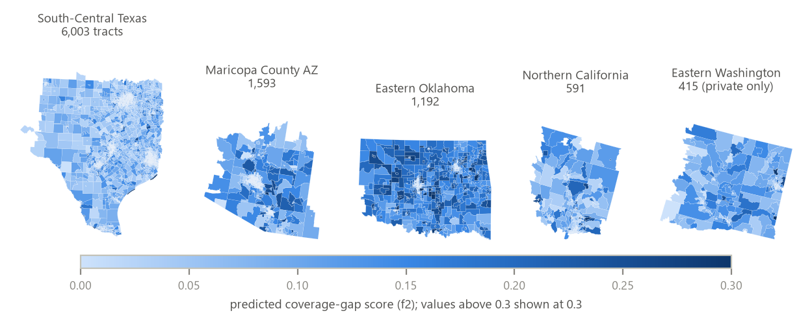

<!-- footer: Coverage-gap scores without labels · Arnaud_TOE -->
<!-- author: Arnaud_TOE -->

<div class="cover" markdown="1">

<p class="kicker">Bias Bounty Mapping Equity Challenge · Best Documentation entry</p>

# Coverage-gap scores without labels

<p class="subtitle">A measured, reproducible pipeline for a score whose reference layers had been withdrawn</p>

<p class="byline">Zindi user <b>Arnaud_TOE</b> (individual) · Version 1.0 · 1 November 2026</p>

<div class="tiles">
<div class="tile"><b>0.058710</b><br>private RMSE of the final blend f2, rank 36, with no label and no withdrawn layer</div>
<div class="tile"><b>81</b><br>files submitted, each with its purpose, expected score and SHA-256 logged before upload</div>
<div class="tile"><b>r = 0.987</b><br>agreement of 73 signals' correlations measured on the public 30 % and the private 70 %</div>
<div class="tile"><b>61 / 61</b><br>signal files of f2 rebuilt bit for bit from the raw data, in one 49-minute run</div>
</div>

<p class="lede">On 25 September the four reference layers left the challenge package, and with them every way to
compute the target. We kept the organiser's formula and replaced each unknown reference count with a random
variable built from permitted data (Section 4). The public leaderboard then served as a measuring instrument:
two constant files gave the mean and spread of the hidden truth, and every later file gave one covariance with
it (Section 6). The final file combines 60 such measurements in closed form. They held on the private set
(Section 8), and one command rebuilds the final file bit for bit from the raw data (Section 11).</p>


*Figure 1. The pipeline. Every box except "Zindi public RMSE" runs locally and is deterministic; Zindi only
returns one public RMSE per uploaded file.*

<p class="ids"><b>Associated submissions:</b> <b>8DPgZvCX</b>, final blend f2 (public 0.057508, private 0.058710,
rank 36 on the private leaderboard), and <b>EboKdJHP</b>, s111, second selection. Every other submission ID is in
Appendix A.<br><b>Code, data checksums and every submitted file:</b>
<a href="https://github.com/Arnaud-TOE/bias-bounty-coverage-gap">https://github.com/Arnaud-TOE/bias-bounty-coverage-gap</a></p>

</div>

<!-- CONTENTS -->

<p class="boxtitle">Where to find what the Info page asks for</p>

| What the Info page asks for | Where |
|---|---|
| Data sources | Section 2 |
| How each component was computed | Sections 3 and 4 |
| Edge cases: zero-population, water-dominated and no-Overture tracts (and others) | Section 5 |
| Alternative weightings and why | Section 7 |
| Reflection on the Bias Scorecard | Section 9 |
| Reproduction | Section 11: `python scripts/reproduce.py` rebuilds the final file bit for bit; `--full` rebuilds everything from the raw data |

<p class="boxtitle">Three ways to read this document</p>

- **In ten minutes:** the first page, the Summary, Figures 1–3 and Section 8.
- **To audit the rules:** Sections 1 and 10, then Appendix A: every file, its purpose and its expected score,
  logged before upload.
- **To reproduce:** Section 11. One command rebuilds f2 in about ten seconds; a second rebuilds everything from
  the raw data in 49 minutes.

## 0. Summary

1. **There are no labels.** The reference layers (TIGER roads, Microsoft footprints, USGS/HIFLD facilities,
   County Business Patterns) were withdrawn and rebuilding the target with them is forbidden. Nothing can be
   trained in the usual sense.
2. **We modelled the organiser formula itself.** For every tract and component, the Overture count O is
   observed exactly. The reference count R is unknown, so it is drawn from a distribution built only from
   permitted data. The exact formula `1 − min(1, O/R)`, with its undefined cases, is averaged over 1,000
   Monte-Carlo draws (Section 4).
3. **We used the public leaderboard as a measuring instrument, not as an oracle.** Two constant submissions
   gave the public target mean and standard deviation exactly. After that, every submitted file gave one number:
   its covariance with the hidden truth. We submitted 74 such measurements (81 files in all, with the constants,
   one probe and the blends). Before each upload we logged an expected RMSE and the file's SHA-256 (Section 6).
4. **The final file is a closed-form, ridge-regularised linear blend of 60 measured signals.** The weights are
   `w = (C + λ·diag C)⁻¹ c`. No tract-level value was ever inferred, and no group smaller than 300 scored tracts
   was ever probed.
5. **The method held out of sample.** For 73 signals, the correlation with the truth implied by the public
   30 % and the one implied by the private 70 % agree with r = 0.987 (Figure 2).
6. **Everything reruns.** `python scripts/reproduce.py` rebuilds f2 bit for bit in about ten seconds.
   `python scripts/reproduce.py --full DIR` rebuilds every feature and every signal from the raw challenge data in a
   fresh environment. On 1 November all 61 signal files and f2 itself came out bit for bit identical to the
   files Zindi scored (Section 11).

## 1. The problem as it stood, and the rules we set ourselves

The target is the organiser's composite coverage-gap score, between 0 and 1, for 9,794 Census tracts. It is the
mean of the **defined** components among three:

- **transport:** Overture motorway/trunk/primary/secondary km against TIGER S1100+S1200 km;
- **building:** Overture footprints against Microsoft footprints;
- **POI:** the mean of two halves:
  - a facilities half, which is the mean of the fire, EMS and school gaps against USGS/HIFLD;
  - an establishments half: all Overture places against CBP establishments.

Each gap is `1 − min(1, O/R)` and is undefined when R = 0. On 25 September the four reference layers left the
package and reconstructing the target became a rule breach. On 8 October the staff confirmed that no
tract-level label exists. The only feedback left was one public RMSE per submission, computed on about 30 % of
the scored tracts.

This shaped every choice. We wrote the following rules into `docs/decisions.md` before using the leaderboard.
They are enforced in code where possible.

| Id | Rule | How it is enforced |
|---|---|---|
| C1 | Never read a withdrawn layer, or a copy of one. Never use other participants' predictions, the scorecards of near-zero RMSE rows, or published group means. | `src/bbx/io.py` refuses any path matching `tiger`, `microsoft`, `hifld`, `usgs-structures`, `cbp`, `coverage-gap`… (unit test `tests/test_guard.py`) |
| D2 | Never use strata columns derived from building footprints: USFS building, housing-unit and population layers (built on Microsoft footprints), and `carbonplan_buildings`. | The same module drops them on read (`drop_forbidden_columns`). |
| D1 | Use the leaderboard only to measure global quantities. The cap rose from 20 to 74 measured signals over the month, with the user's agreement at each step. Signals must be continuous or cover a group of at least 300 scored tracts, all weights are ridge-regularised, and nothing is probed at the tract level. | Every file's purpose and expected RMSE are logged before upload (`submissions/log.csv`). The cap is checked in `scripts/make_finals.py`. |
| — | External data only for the Bias Discovery prize, never imported by `src/`. | `discovery/` is a separate tree. |

## 2. Data sources

All data come from the public Source Cooperative bucket
`s3://us-west-2.opendata.source.coop/humane-intelligence/bias-bounty-mapping-equity-challenge`. They were retrieved
on 16 October 2026 with `aws s3 sync --no-sign-request`. All **202 files** are checked against the bucket
listing (byte counts, `data/bucket_listing.txt`) and a SHA-256 manifest (`data/MANIFEST.sha256`) by
`scripts/verify_download.py`.

| Dataset | File pattern | Version | Used for |
|---|---|---|---|
| Overture buildings | `reference/<region>/<region>-overture-buildings.parquet` | release 2026-08-19.0 | building counts, sources, sizes, OSM names and classes |
| Overture roads (drivable classes) | `…-overture-roads.parquet` | 2026-08-19.0 | scored-class km O, route networks (`routes[].network`), names |
| Overture roads (unfiltered), rail, infrastructure | `…-overture-roads-unfiltered.parquet` etc. | 2026-08-19.0 | service roads, tracks, road history |
| Overture places | `…-overture-pois.parquet` | 2026-08-19.0 | fire, EMS and school counts (organiser category lists), all places, alternate categories |
| ACS B25001 housing units | `…-census-acs-housing.parquet` | ACS 2020–2024 | housing units |
| Strata table (232 columns) | `strata/<region>/<region>-strata-tract-table.parquet` | per-source vintages | population (urban/rural), RUCA, SVI, CVI, tribal overlap, hazards |
| Tract polygons | `strata/<region>/<region>-census-tracts.parquet` | TIGER 2025 cartography, 2020 tracts | spatial joins, land area (ALAND) |
| Scored tract list | `reference/<region>/<region>-sample-submission.csv` | — | 9,794 GEOIDs: TX 6,003 · AZ 1,593 · OK 1,192 · CA 591 · WA 415 |

**Never read by the scoring pipeline:**
- TIGER roads, Microsoft footprints, HIFLD/USGS facilities, CBP, and any equivalent copy;
- the footprint-derived strata columns (`usfs_Building*`, `usfs_HU*`, `usfs_Pop*`, `carbonplan_buildings`);
- bookkeeping strata columns (vintages, labels, names), which carry no signal.

The organiser category lists are copied verbatim into `src/bbx/config.py`:
- fire: `fire_department`;
- EMS: `ambulance_and_ems_services`;
- schools: six categories, `elementary_school` … `public_school`.

**Public knowledge we used, with credit.** Some calculation conventions of the reference come from methods
that participants published on the Zindi discussion board. We used the conventions as knowledge. We never used
their code, their files or the withdrawn layers.
- *PeterTheDataScientist*: the reference clips TIGER lines to tracts in EPSG:5070 and keeps one record per route
  number.
- *HHYurdagul* ([#35478](https://zindi.world/competitions/bias-bounty-mapping-equity-challenge/discussions/35478)): a highway running along a tract boundary is credited to both tracts.
- *iam-dante*: TIGER keeps a duplicate record for a route's local name.
- *Luca925* ([#34925](https://zindi.world/competitions/bias-bounty-mapping-equity-challenge/discussions/34925)): a pattern for fire stations filed under other categories.

The TIGER technical documentation (2024 edition, section 4.12.4) confirms that the All Roads files hold one
spatially coincident segment per road name.

## 3. Per-tract features

All features are built with DuckDB spatial (`src/bbx/features*.py`), one row per scored tract. The modelling
table has 9,794 rows × 267 columns, plus 147 columns in eight extra feature files built in later passes.

**Geometry conventions**, unit-tested in `tests/test_data_contract.py`:
- The layers are lon/lat (OGC:CRS84). Spheroid lengths use `ST_Length_Spheroid(ST_FlipCoordinates(geom))`.
  Without the flip, the EPSG:4326 axis order silently returns NaN. The test checks a known motorway against its
  EPSG:5070 length (difference under 1 %).
- Planar measurements are in EPSG:5070, the organiser's projection: clipped km, distances to the boundary,
  buffers.
- GEOID is always text. 2,183 GEOIDs start with 0 (Arizona 04, California 06).
- All areas use **ALAND** (land only), with a 0.01 km² floor, so water never dilutes a density.

| Group | Main features (per tract) | Module | Check |
|---|---|---|---|
| Roads | km of each Overture class clipped to the tract; km by **route level** (highest `routes[].network`: Interstate, US, state, Texas FM/RM/Loop/Spur, county, other); unnamed km; km last edited before 2012 | `features.py` | 79,164 km clipped against 79,064 km in the layer (+0.13 %, boundary overlaps) |
| Road reference artefacts | route km within 10 m outside the tract (boundary band); route km weighted by the number of distinct route designations (multiplicity); local-name km; long boundary runs (> 232 m in a 30 m ring) | `features_roadref.py`, `features_bandruns.py`, `scripts/build_uncounted_majors.py` | ratios against the published 0.71–1.59 range (Section 4.1) |
| Buildings | count by centroid, first source (OSM, Microsoft ML, Esri, USGS), multi-source, footprints under 50 m², area; hand-drawn footprints absorbing Microsoft ones | `features.py`, `features_bldref.py` | 1,081,345 of 1,081,346 eastern-wa footprints assigned |
| Places | organiser category counts; fire stations filed under other categories (name pattern, vendors excluded); alternate categories; closed places; community anchors; facilities within 300 m / 1 km across the boundary; postcodes | `features.py`, `features_extra.py`, `features_osmfac.py` | category lists identical to the README |
| Facility evidence in buildings | OSM fire-station, EMS and school buildings (Overture buildings carry OSM names and classes; Overture places do not) | `features_osmfac.py` | — |
| Business proxies | large-building counts and areas, distinct place addresses, dominant postcode | `features_bizaddr.py` | — |
| Strata | population (urban/rural), RUCA, SVI, CVI, tribal overlap, wildfire, heat, drought | `dataset.py` | footprint-derived columns dropped |

Totals over the 9,794 tracts:
- 19,169,788 buildings;
- 2,001,075 places;
- 192,520 km of scored-class roads;
- 1,069,751 km of drivable roads.

## 4. How each component was computed

### 4.0 Principle: the expected value of the exact formula

For tract t and component k, the organiser computes `g = 1 − min(1, O/R)`. It is undefined when R = 0, and the
score is the mean of the defined components. O is observed exactly from Overture. R is replaced by a random
variable whose law uses permitted data only. The prediction is the **Monte-Carlo expectation of the exact
formula**, undefined cases included:

```
score(t) = E[ mean over defined k of (1 − min(1, O_k / R_k)) ],   1,000 draws, seed 20261016
```

The undefined cases matter: when one component is undefined, the score is the mean of the other two, so the
divisor changes from tract to tract. This expectation is the RMSE-optimal point prediction under the stated
beliefs. `src/bbx/structural.py` also returns each component's **exact additive contribution** to the expected
score: `c_k = E[1(k defined) · g_k / n_defined]`, so the contributions sum to the score (unit-checked). These
contributions are what we submit as signals: each one measures how well one mechanism tracks the truth.

### 4.1 Transport: the decisive component

Removing the 17 transport signals would add +0.0122 to the expected RMSE of the final blend (Figure 5).

**O, the Overture side.** Km of `motorway`, `trunk`, `primary` and `secondary`, clipped to the tract polygon in
EPSG:5070. This is the organiser's own definition, so it is exact.

**R, the TIGER S1100+S1200 length, is not observable.** We model it as

```
R = proxy × exp(0.5 · ε),   ε ~ N(0, 1)
proxy = major km × multiplicity
      + boundary credit
      + w_FM · Texas Farm/Ranch-to-Market km
      + w_cty(region) · county-route km
      + w_loc · local-name copies
```

The pieces are as follows.

- **Major km.** The route-tagged km of Interstate, US and state highways. They also include the state loop,
  turnpike and toll systems that TIGER files as primary or secondary roads: Phoenix Loops 101/202/303,
  the Oklahoma turnpikes, and the Texas Loops, Spurs, Beltways and toll roads.
- **Multiplicity.** TIGER keeps one record per route number, and the reference keeps every copy. A segment
  carrying I-35 and US-81 therefore counts twice.
- **Boundary credit.** Tract boundaries follow TIGER road edges, so a highway that forms a boundary is credited
  in full to both tracts. Overture's copy, a few metres to one side, lands in only one of them. We measure route
  km within 10 m outside the tract (v3, v7), or long runs of more than 232 m within a 30 m outer ring (v9).
- **Calibration of the two free weights.** `w_FM` and `w_cty` are solved from the organisers' published figures
  only. The Info page gives the Overture/TIGER length ratio as 0.71 to 1.59 across the four regions. Texas sits
  at the top of the range and Oklahoma at the bottom; Arizona and California fall inside it without being
  fitted (1.32 and 1.43 under v7L).
- **Definedness.** The transport component is defined when R > 0. Its probability is:
  - 1 with any major route;
  - 0.19 when the only routes are Texas FM/RM roads;
  - by region when the only routes are county routes: Oklahoma 1, Arizona 0, California 0;
  - 0.03 with no route at all.

  These values reproduce the published shares of tracts with at least one undefined component:

| Region | Published | Model v7 |
|---|---|---|
| Eastern Oklahoma | 21 % | 21.1 % |
| Northern California | 37 % | 37.9 % |
| South-Central Texas | 28 % | 26.8 % |
| Maricopa | 55 % | 52.5 % |

**Successive versions.** Each version was measured by submitting its transport contribution alone. ρ is the
implied correlation with the truth, on the public and private sets.

| Version | Mechanism added | Signal | Public RMSE | ρ public / private |
|---|---|---|---|---|
| v1 | route-level proxy, definedness calibrated to the published shares | s06 | 0.08210 | 0.42 / 0.40 |
| v3 | boundary credit (10 m band) and route multiplicity | s77 | 0.07426 | 0.56 / 0.57 |
| v7 | route classification fixed: Phoenix Loops and Oklahoma turnpikes are highways; Texas FM/RM nearly absent from TIGER (w_FM 0.112, w_cty OK 0.152) | **s97** | **0.06648** | **0.67 / 0.70** |
| v9 | boundary credit from long runs in a 30 m ring (w_FM 0.005, w_cty 0.095) | s106 | 0.06902 | 0.64 / 0.66 |
| v7L | local street names as one more TIGER record (weight 0.25; w_FM 0.051, w_cty 0.075) | s140 (v7L − v7) | 0.08630 | 0.35 / 0.40 |
| v7LF | local names of Interstates and Texas loops as well | s146 (delta) | 0.08851 | 0.14 / 0.06 |
| v7Linv | the published ratio read the other way round (TIGER/Overture): local names 0.35, w_FM 0.175, w_cty 0.235 | s147 (delta) | 0.08578 | 0.40 / 0.37 |

**Key finding:** the v3 → v7 step was our largest single gain (public 0.0743 → 0.0665). It came from reading
Overture's `routes[].network` correctly: `US:AZ:Loop` and `US:OK:Turnpike` are freeway systems, not county
roads. It also came from recognising that the 50,600 km of Texas FM/RM roads are almost all S1400 in TIGER.

The deltas (v7L, v7LF, v7Linv) are submitted as differences from their parent, with the same random draws.
This lets the blend weigh each mechanism separately.

### 4.2 Building

- **Model.** `R = round(O × exp(−0.05 + 0.15·ε))`. The README says Overture usually holds at least as many
  footprints as the reference, so the expected building gap is small everywhere.
- **What the leaderboard said.** The building family adds only 0.0002 to the final blend.
- **One informative proxy.** The best building signal is the **share of Overture buildings sourced from
  Microsoft ML** (s13, ρ = 0.29 / 0.30). Where local mapping is thin, the other components have gaps too.
- **Other signals measured:**
  - footprints under 50 m² (s27);
  - Esri-sourced share (s28);
  - buildings per ACS housing unit (s26, negative);
  - hand-drawn footprints that absorb several Microsoft ones (s80).

### 4.3 POI: fire stations, EMS, schools and establishments

**Facilities half.** For each type, the reference count is H = M + K:
- M ~ Binomial(O, π) are the Overture records that are real reference facilities;
- K ~ Poisson(max(λ − π·O, 0)) are the facilities the map misses.

| Type | π | λ (expected reference facilities) | Extra evidence that forces H ≥ 1 |
|---|---|---|---|
| Fire (v1) | 0.8 | rural pop/4,000 + urban pop/18,000 + km²/2,500 (national aggregates, about 29,700 US stations) | a station name filed under another category: P = 0.85 |
| Fire (v8) | 0.8 | same | name-verified misfiled station (vendors excluded), OSM fire-station building, `fire_department` as alternate category: P = 0.9 |
| Fire (v9) | 0.8 | rural pop/**2,000** + urban pop/**36,000** + km²/2,500 | v8 evidence plus **town cores** (RUCA 4 and 7): P = 0.9 |
| EMS | 0.9 | 0.9·O + 0.1·Ô (Ô: Poisson GLM smoothing of Overture counts on population, area, rurality, region) | — |
| Schools | 0.9 | 0.9·O + 0.15·Ô | — |

The facilities half is the mean over the defined types.

The v8 and v9 changes were each measured before adoption:

| Fire change | Signal | ρ public / private |
|---|---|---|
| Clean station evidence | s100 | 0.17 / 0.17 |
| Town-core stations | s134 | 0.17 / 0.16 |
| Recalibrated rural and urban rates | s136 | 0.28 / 0.29 |
| Rural populated tract with no Overture station | s14 | 0.21 / 0.23 |

Rural volunteer stations are numerous and poorly covered by Overture places. City stations are fewer per
resident and well covered.

**Establishments half.** The proxy is
`R = round(√(max(0.0243·pop, 0.5) · max(places/2, 0.5)) × exp(0.5·ε))`, with 0.0243 establishments per
resident nationally and about two Overture places per establishment. The organisers allocate ZIP-level CBP
counts to tracts with a crosswalk of business addresses, which we may not use. We therefore submitted several
**allocation hypotheses** as separate signals and let the leaderboard weigh them:
- by area (s24, s38);
- by population (s25);
- by housing units (s36);
- by ZIP spread (s42, s43);
- by large-building and business-address proxies (s86).

Individually these signals are weak, sometimes negative. Their contrasts carry +0.0020 in the blend.

### 4.4 The composite, and what we learned about it

The composite is the mean of the defined components, with the POI component itself a mean of its halves. The
model reproduces the formula's undefined cases exactly, draw by draw.

**Weakness 1: the level is off.** The structural composite averages 0.095–0.107 on the four regions,
depending on the version. The measured public mean is 0.0598, so the facility terms over-predict gaps.

**Weakness 2: the formula's weights are not the best weights.** The composite with the formula's own weights
predicts worse than its transport part alone:

| Model | Composite | Transport contribution alone |
|---|---|---|
| v1 | ρ = 0.33 (s04) | 0.42 (s06) |
| v3 | ρ = 0.47 (s79) | 0.56 (s77) |

We therefore use the structural model as a **generator of mechanisms**: contributions, probabilities of
definedness, and the edges of the score's distribution. The leaderboard weighs them (Sections 6–7). The
probability that the score reaches 0.30 (s117, ρ = 0.38) is one such edge. A linear blend cannot reproduce the
skewed tail of the score without it.

## 5. Edge cases

Counts are over the 9,794 rows, recomputed from the modelling table.

| Case | Tracts | How it is handled |
|---|---|---|
| **Zero population**<span class="sep"> (</span><span class="pill info">Info page</span><span class="sep">)</span> | 27 (67 with < 100 residents; 63 special-use 98xx tracts) | Kept and scored like the others. Per-capita priors use a floor, so their facility expectation rests on land area. `pct_urban` is missing (27 tracts) and falls back to the regional median where a model needs it. 25 of the 27 have buildings and 20 have scored roads, so no rule fixes their score. |
| **Water-dominated**<span class="sep"> (</span><span class="pill info">Info page</span><span class="sep">)</span> (water > 50 % of the polygon, polygon area against ALAND) | 43 (40 in Texas: Gulf coast bays and large reservoirs; 171 tracts are over 25 % water) | Every area and density uses ALAND, never the polygon area, so water does not dilute densities. Otherwise they are modelled like any other tract. |
| **Pure water, no Overture data at all**<span class="sep"> (</span><span class="pill info">Info page</span><span class="sep">)</span> | 2: 48039990000 and 48057990000 (ALAND = 0) | **Formula rule** (`src/bbx/postprocess.py`, unit-tested). A scored tract has at least one defined component, and with O = 0 every defined component equals 1. Their score is therefore exactly **1.0**, written into every final file. |
| …and their effect on measurement | the same 2 | A signal extreme on those two tracts gets a measured covariance driven by whether they fall in the public 30 %. Since 25 October every new signal is set to the target mean m on them (`bbx.signals.write_signal`). The 46 older signals kept their values (and rebuild with them, `LEGACY_WATER_SCRIPTS`); s07 is 18–20 standard deviations above its mean there (Sections 7–8). |
| No scored-class Overture road | 137 | The transport component is defined only through the route-based reference probability. Its gap is 1 when defined. |
| No major route (transport likely undefined) | 3,788 | The probability of definedness is calibrated as in Section 4.1. |
| No Overture fire / school / EMS place | 6,912 / 2,100 / 9,078 | The gap comes from the facility priors (Section 4.3). |
| Zero housing units | 82 | Housing-unit ratios are NaN and replaced by the median when a signal is standardised. |
| Missing SVI / CVI | 88 / 2 | Median fallback, used only in signals and in the bias analysis. |
| GEOID as text | all; 2,183 with a leading zero | Read with `dtype=str` everywhere; the test checks 1,592 Arizona GEOIDs keep "04". |
| New Mexico tract in the Maricopa package | 35023970000 | Treated as part of maricopa-az, as the Info page says. |
| **Eastern Washington** | 415 | The Info page says that all scored tracts are in the other four regions. Probe s124 (1.0 on these tracts, m elsewhere) scored exactly the public sd: **not public**. The finals therefore fit their weights on the four regions and carry them to Washington without region-specific signals. After the close, the private scores showed that **all 415 tracts are in the private set** (Section 8). |
| Submission format | — | Exactly `GEOID,coverage_gap_score` in the official row order. The grader reads the first column after GEOID ([#35361](https://zindi.world/competitions/bias-bounty-mapping-equity-challenge/discussions/35361)), and the official sample puts `transport_gap` there. Values are clipped to [0, 1] (clipping can only lower the RMSE), with 6 decimals. |
| Unscored 99xx tracts in the package | 7 | Never used. |

## 6. From mechanisms to a submission: the leaderboard as an instrument

### 6.1 The algebra

For a file p scored on the public subset, where the target has mean m and standard deviation s:

```
RMSE² = Var(p) + s² − 2·Cov(p, y) + (mean p − m)²
```

- Two constants, 0 and 0.10 (s01, s02), give **m = 0.059806** and **s = 0.089022** exactly
  (`bbx.lb_algebra.moments_from_constants`).
- Every later file then gives `Cov(p, y)`, and hence its correlation with the truth. The moments of p are taken
  over all tracts of the scored regions, as a proxy for the unknown public subset.

### 6.2 Signals

A mechanism x is submitted as `p = m + k·s·z(x)`, clipped to [0, 1], where z is the standardised mechanism and
k is a modest scale (`bbx.signals.write_signal`). Each file is therefore a sensible prediction on its own.
Before upload, `bbx.submit.write` validates the file and logs it:
- 9,794 unique GEOIDs, no blanks, values in [0, 1];
- its SHA-256, mean, sd, purpose and expected public RMSE are appended to `submissions/log.csv`.

After upload, `bbx.submit.record` stores the Zindi ID and score. All 80 logged scores were checked against the
Zindi Submissions tab, with no difference.

### 6.3 The blend

```
ŷ = m + Σᵢ wᵢ (pᵢ − mean pᵢ),    w = (C + λ·diag C)⁻¹ c,    expected RMSE = √(s² − 2w·c + w·C·w)
```

- C is the covariance of the signals over the four scored regions and c the vector of measured covariances.
- Eastern-wa tracts get a second blend without region-specific signals (`fit_without_wa` in
  `scripts/make_finals.py`).
- The formula rule (Section 5) and clipping are applied last.
- f2 uses **60 signals with λ = 0.005**. Its weights are stored in
  `submissions/final_f2_blend_ridge0005_with_s07_s22_weights.json` and listed in Appendix A. They apply to the
  submitted files, so their size depends on each file's scale k.

### 6.4 Does the instrument work? Pre-registered blends against reality

| Blend | Signals, ridge | Expected public (logged before upload) | Public | Private |
|---|---|---|---|---|
| s16 (first blend, 18 Oct) | 8, λ = 0.05 | 0.077974 | 0.078204 | 0.079596 |
| s111 (validation blend, 26 Oct) | 45, λ = 0.005 | 0.059738 | 0.059990 | 0.061256 |
| **f2 (final, 31 Oct)** | 60, λ = 0.005 | 0.054996 | **0.057508** | **0.058710** |
| f5 (sent after the close, not ranked) | 58, λ = 0.02 | 0.056746 | 0.056982 | 0.058048 |

**Key finding:** three of the four blends landed within 0.0003 of the logged expectation. The fourth, f2, missed
by 0.0025; Section 8 explains why.

{: style="width:58%"}
*Figure 2. Each signal's correlation with the truth, measured twice: from its public RMSE (30 % of tracts) and
from its private RMSE (70 % plus eastern-wa). The private moments come from the same two constants
(m = 0.059915, s = 0.089342). Over 73 signals r = 0.987. The differences have sd 0.031, a little above the
pure sampling noise of a correlation measured on 2,814 tracts (about 0.02), as expected with heavy-tailed
signals. The measurements replicate out of sample.*

### 6.5 Controlling over-fitting

1. **Few, global parameters.** One weight per measured signal and nothing at the tract level.
2. **Continuous signals or large groups.** Every regional or metro copy covers at least 300 scored tracts.
3. **Ridge on every weight.** λ was chosen by an end-to-end simulation (`docs/05_plan_audit.md`, check C2):
   - draw synthetic truths around the blend;
   - draw a random public 30 %;
   - recompute every implied covariance from simulated RMSEs;
   - refit the blend and score it on the synthetic private 70 %.

   The simulation recovered the covariances to within 1.4 % and favoured λ between 0.001 and 0.005.
4. **WEAK rule.** A recent signal whose removal raises the expected public RMSE by less than 0.00003 is left out
   of the finals. Thirteen signals are left out this way, among them the four metro copies s125–s128.

## 7. Alternative weightings, and why we chose what we chose

| Alternative | What it means | Evidence | Decision |
|---|---|---|---|
| **The formula's own component weights** (equal mean of defined components) | Submit the structural composite | Composite ρ 0.33 (v1) and 0.47 (v3), below its own transport part (0.42, 0.56) | <span class="pill no">Rejected</span><span class="sep">: </span>the leaderboard weighs mechanisms. On 26 October the blend gave the v7 transport contribution about 1.25 times its model weight. |
| **Component level against contribution** | Submit the transport gap g itself, not its share g/n_defined of the score | v7 gap s101 ρ 0.47, against v7 contribution s97 ρ 0.67 | <span class="pill yes">Kept</span><span class="sep">: </span>the contribution, which carries the formula's divisor. |
| **Population weighting** | Weight tracts by residents | The metric is an unweighted RMSE over tracts | <span class="pill no">Rejected</span><span class="sep">: </span>the metric weighs every tract equally. |
| **One weight per region** | Region-restricted copies of transport and fire | Oklahoma transport copy s83: ρ 0.44 alone and the largest marginal gain of its day. Arizona, California and Texas copies: smaller gains | <span class="pill yes">Kept</span><span class="sep">: </span>in the blend. The weights are not used for eastern-wa, which is absent from the public set. |
| **One weight per metro area** | Houston, Phoenix, San Antonio and Austin copies (s125–s128) | −0.00010 in total | <span class="pill no">Dropped</span><span class="sep">: </span>by the WEAK rule. |
| **Allocation of CBP establishments** | By area, population, housing units, ZIP spread or business proxies | Each alone ρ between −0.11 and +0.10; together +0.0020 in the blend | <span class="pill yes">All kept</span><span class="sep">: </span>each one measured and weighed by the blend. |
| **Ridge strength** | λ = 0.005 (f2) against 0.01 (f3) and 0.02 (f5) | Simulation: λ 0.001–0.005 best. Reality: f5 (λ 0.02, without s07/s22) private 0.058048, better than f2's 0.058710 | <span class="pill yes">λ = 0.005</span><span class="sep">: </span>chosen on the simulation for f2. In hindsight more shrinkage was better, but the comparison is confounded with s07/s22 (next row). |
| **With or without s07/s22** (two signals driven by the water tracts) | f1/f3/f5 drop them; f2 keeps them | Their covariance depends on whether the two water tracts are public. s07's implied correlation flips sign from public (+0.013) to private (−0.054) | <span class="pill hedge">Hedged</span><span class="sep">: </span>f2 kept them, as one side of a hedged pair. The private result favours dropping them (f5). |
| **Ridge towards the structural composite** instead of towards zero (f4) | Shrink the weights towards those that reproduce structural v9L | Formula: slight gain. End-to-end simulation: worse in 95 % of synthetic truths | <span class="pill no">Rejected</span><span class="sep">: </span>the simulation outweighs the formula. |
| **Pruning weak signals** | WEAK rule against keeping every signal (f1) | Simulation: if those signals are noise, keeping them costs 0.0002 of private RMSE; if they are real, dropping them costs nothing | <span class="pill yes">Applied</span><span class="sep">: </span>to f2, f3 and f5. |
| **Hedged selection** | Two finals that differ where we are unsure | Zindi keeps the better of the two selected files on the private set | <span class="pill hedge">Hedged</span><span class="sep">: </span>f2 + s111 selected, and checked on every page because of a Zindi selection bug (thread [#35607](https://zindi.world/competitions/bias-bounty-mapping-equity-challenge/discussions/35607)). |

## 8. What the private leaderboard taught us


*Figure 3. Public against private RMSE for every scored file. The ranking of files is preserved (rank
correlation 0.94). Single signals lose 0.0003 on average from public to private; every blend loses 0.0011 to
0.0014.*

1. **The measurements replicate** (Figure 2). Correlations measured on 2,814 public tracts predict those on the
   private 70 % with r = 0.987.
2. **Blends lose about 0.0012 from public to private, consistently** (s16 +0.0014, s111 +0.0013, f2 +0.0012,
   f5 +0.0011). This is the expected cost of weights fitted on noisy public covariances, plus eastern-wa
   (point 4).
3. **f2's public miss had one cause.** f2 scored 0.0025 above its expectation; f5 missed by only 0.0002.
   - For a linear blend B = a + Σ wᵢ pᵢ, the public MSE is an exact, truth-free function of the signals'
     public RMSEs, except for one term: `mean_public(B² − Σ wᵢ pᵢ²)`, which depends on which tracts are public.
   - In f2 the two empty water tracts (fixed at 1 by the formula rule) carry values of that term of 0.70 and
     0.66. No other tract exceeds 0.01. The cause is s07, weighted +3.1 and 18–20 standard deviations above its
     mean on those two tracts.
   - Depending on whether zero, one or both of them are public, this term alone moves f2's public RMSE by about
     −0.0013, +0.0009 or +0.0030. The observed shift was +0.0025.
   - f5 drops s07 and sits on its expectation.

   **Lesson:** a signal that is extreme on a handful of tracts makes its own measurement fragile. We
   neutralised new signals on those tracts on 25 October, but kept the old ones.
4. **Eastern Washington is in the private set.** Two private scores pin this down:
   - the probe s124: 1.0 on eastern-wa, m elsewhere, private RMSE 0.2385;
   - the indicator s31.

   Solved together, they give eastern-wa a share of 0.0595 of the private set. With 6,565 private tracts in the
   four regions (70 % of 9,379), that is exactly **415 tracts: all of eastern-wa**, with a mean target of 0.093.
   f2 predicted a mean of 0.076 there, with weights carried over from the other regions. The bias costs about
   0.0001 of private RMSE. It is small, but it contradicts the Info page, and it matters for anyone reusing the
   scorecard (Section 9).
5. **What we would do differently:**
   - neutralise every signal on the rule-determined tracts from the first day;
   - prefer the more shrunken final when two candidates are close;
   - measure the Overture/TIGER transport reference with fewer, bolder variants earlier. Transport carries most
     of the gain, and its uncertainty was our largest remaining error.


*Figure 4. Best public RMSE over time and the best private RMSE among the same files (hidden until the close).
The big steps are mechanisms of the transport reference (v3, v7); the blends then add 0.006–0.009.*


*Figure 5. What each family of signals is worth inside f2: the increase of the expected public RMSE (0.0550) when
the whole family is removed. Alone, the 17 transport signals would give 0.0615.*

## 9. Reflection on the Bias Scorecard

**What the scorecard measures for a label-free model.** Zindi's scorecard of a submission is computed from
**that submission's own predictions**, by stratum. We recomputed f2's values exactly from the file: the mean
score by stratum over all 9,794 rows gives rural/urban **2.25×** and tribal **2.71×**, the figures Zindi shows.
It carries no information about the truth. For a model like ours it describes the model's beliefs, so it is
worth reading as a check on those beliefs.

| Stratum (f2) | Disparity ratio |
|---|---|
| Rural / urban | 2.25 |
| Tribal / non-tribal | 2.71 |
| SVI top quartile / bottom quartile | 1.27 |
| CVI top / bottom quartile | 1.59 |
| Wildfire hazard (WHP) top / bottom quartile | 2.03 |
| Summer heat days top / bottom quartile | 0.51 |
| Summer drought (DSCI) top / bottom quartile | 0.85 |


*Figure 6. f2 predictions by tract. Gaps concentrate in rural Oklahoma, the outer counties of Maricopa and the
northern California foothills. Urban cores are near zero.*

Three observations about the scorecard:

1. **Pooling regions inflates the rural disparity.** Within each region, f2's rural/urban ratio is:

   | Region | Rural / urban, within the region |
   |---|---|
   | Texas | 1.83 |
   | California | 1.81 |
   | Oklahoma | 1.88 |
   | Arizona | 3.50 |

   Pooled, the ratio is 2.25. Rural tracts are over-represented in Oklahoma, the region with the highest gaps:
   22 % of rural tracts, against 12 % of all tracts. The Info page itself warns that transport gaps "are not
   comparable across regions", because the Overture/TIGER ratio runs from 0.71 to 1.59. Part of a pooled rural
   disparity is a regional definition effect, not a mapping deficit. We suggest stratifying the scorecard by
   region.
2. **Good RMSE submissions understate extreme gaps.** An RMSE-optimal prediction shrinks towards the mean: f2's
   sd is 0.069, against 0.089 for the target. Apart from the two water tracts fixed at 1, no f2 tract
   exceeds 0.41. Threshold metrics such as
   the POI Desert Index (poi_gap ≥ 0.8) therefore report fewer deserts for better submissions. Group means are
   preserved only when the group is in the model's span, which is why we kept the strata prior s03 (rural and
   tribal shares) in every blend.
3. **The formula itself drives part of the rural and tribal disparity.** The truth combines a one-sided ratio
   (more Overture than reference counts as full coverage) with a variable divisor:
   - a rural tract with no named highway has no transport component;
   - its score is then the mean of building and POI;
   - its POI gap is often 1 for fire stations, because volunteer stations are poorly covered.

   In eastern Oklahoma, county roads and turnpikes decide whether transport is defined at all. Disparities in
   the scorecard thus mix mapping gaps with reference-definition effects. Our structural model separates them
   (the component contributions in Section 4), and we recommend that kind of decomposition to anyone using the
   score for emergency planning.

Finally, **eastern Washington** (415 tracts) is scored in private but appears nowhere in public, so no
participant could calibrate it. Any scorecard pooled over the 9,794 rows includes predictions that were, by
construction, extrapolated.

**Recommendation:** stratify the scorecard by region, and decompose a disparity into the formula's components
(Section 4) before using the score for emergency planning.

## 10. Compliance appendix

| Topic | What we did |
|---|---|
| Never read | Withdrawn layers (TIGER, Microsoft footprints, HIFLD/USGS, CBP) or copies obtained elsewhere; footprint-derived strata columns; other participants' predictions, the scorecards of near-zero RMSE rows, and published group means. The I/O guard and its tests enforce the first two. |
| Leaderboard use | 74 measured signals, the 2 constants, one region-level probe (s124) and 3 blends; f5 was sent after the close (81 files in all). No tract-level or sub-300-tract probing. Every file's purpose and expected RMSE were logged before upload. |
| External data | Only in `discovery/` (our Best Bias Discovery entry, "phantom homes"); never imported by `src/`. |
| Question to the organisers | On the footprint-derived strata columns: <https://zindi.world/competitions/bias-bounty-mapping-equity-challenge/discussions/35402>. No answer came, so the columns stayed excluded. |
| Tools | Python and open-source packages only; no AutoML, no paid API. |
| Coding assistant | A general-purpose coding assistant helped draft code and text. It is not needed to run or reproduce anything (rules: "General-purpose development assistants … may be used"). |
| Licence | Challenge data are CC-BY-SA 4.0. Our derived files are shared under the same licence. |

## 11. Reproduction

**Environment:**
- Windows 11 Pro, Intel Core i7-10610U laptop (4 cores), 32 GB RAM, no GPU;
- Python 3.13, duckdb 1.5.6, pandas 3.0.6, numpy 2.5.4, statsmodels 0.15.0, geopandas 1.2.0 (all pinned in
  `requirements.txt`);
- the structural model uses seed 20261016.

```bash
python -m venv .venv
.venv/Scripts/pip install -r requirements.txt        # .venv/bin/pip on Linux/macOS
.venv/Scripts/pip install -e .
B=s3://us-west-2.opendata.source.coop/humane-intelligence/bias-bounty-mapping-equity-challenge
python -m awscli s3 sync $B/reference/  data/raw/reference/  --no-sign-request
python -m awscli s3 sync $B/strata/     data/raw/strata/     --exclude "*.csv" --no-sign-request
python -m awscli s3 sync $B/boundaries/ data/raw/boundaries/ --no-sign-request
python scripts/verify_download.py       # 202 files: byte counts and SHA-256
python -m pytest -q                     # 13 tests: guard, algebra, data contract, formula rule
```

**Depth 1: the final file from the archived signals (about 10 s).**

```bash
python scripts/reproduce.py
```

The script:
- checks the SHA-256 of every signal file of f2 against `submissions/log.csv`;
- refits the blend exactly as `scripts/make_finals.py` does;
- writes it to a temporary folder in the submission format.

Result on 1 November 2026: **f2 SHA-256 `efbc9bcbe0d3386c…`, identical to the file Zindi scored
(8DPgZvCX)**. The same holds for f5 (`5ff4d8370ab1ca34…`).

**Depth 2: everything from the raw data, in a fresh copy.**

```bash
python scripts/reproduce.py --full <empty folder>
```

The script:
1. copies the code to the folder and links the verified raw data;
2. creates a new virtual environment from `requirements.txt`;
3. runs the data check, the feature builders and the 24 scripts that wrote f2's signals, in their original order;
4. compares every regenerated signal file with the submitted one;
5. rebuilds f2 inside the copy.

Result on 1 November 2026, in one uninterrupted run from an empty folder (report in
`docs/reproduction_report_2026-11-01.md`):
- the per-tract features rebuilt from the raw data equal the archived ones to within floating-point summation
  order (largest difference 1×10⁻⁸, on footprint areas in m²; DuckDB aggregates in parallel);
- **all 61 signal files of f2 regenerated bit for bit**, with the SHA-256 of the files Zindi scored;
- f2 and f5, rebuilt inside the copy, are identical to the submitted files;
- run time on the laptop above: **49 minutes**, made up of 4 minutes for the environment, 40 for the feature
  builders and 5 for the 24 signal scripts and the tests.

Two fixes were needed to get there. Both are part of the published code:
- **Older signals keep their original treatment of the water tracts.** The 46 signals prepared before 25 October
  predate the neutralisation of the two water tracts, so `bbx.signals.LEGACY_WATER_SCRIPTS` lets them keep their
  original values there.
- **The first blend sees the scores it saw at the time.** s16 (not part of f2) was built from the scores Zindi
  had returned by then, so the full mode records each score in the copy's log at its historical date.

**Where things are:**

| Path | Content |
|---|---|
| `src/bbx/` | package: config, guarded I/O, features, structural model, signals, leaderboard algebra, blend, formula rule, submission writer |
| `scripts/make_*.py` | one script per submission batch, named after the files it writes |
| `scripts/make_finals.py`, `scripts/make_f5.py` | the final blends |
| `scripts/reproduce.py`, `scripts/make_doc_figures.py` | reproduction, and every figure and number of this document |
| `submissions/` | every submitted CSV, `log.csv` (SHA-256, purpose, expected and public RMSE, Zindi ID), `zindi_scores_final.csv` (public and private scores read after the close) |
| `docs/` | analysis, plan, decision log (`decisions.md`), daily journal (`journal.md`, French), audit plan (`05_plan_audit.md`), reproduction report (`reproduction_report_2026-11-01.md`) |
| `tests/` | unit and data-contract tests |

<div class="newpage"></div>

## Appendix A. Every submission

Expected = public RMSE logged before upload. Single signals were logged with a guessed correlation; blends were
logged with the algebra of Section 6. ρ pub / priv = correlation with the truth implied by the public and by the
private RMSE (Figure 2). The weight column gives the weight in f2, in units of the submitted file. f2 lists 61
signals; the eastern-wa indicator s31 is constant on the four scored regions and drops out. Files without a
weight were left out of f2: blends, constants, the probe, and the WEAK signals (Section 6.5).

<div class="small" markdown="1">

| File | Zindi ID | What it measures | Expected | Public | Private | ρ pub / priv | Weight in f2 |
|---|---|---|---|---|---|---|---|
| `s01_const_000` | hz2e3ofY | constant 0.00: measures target mean and sd | 0.10817 | 0.10725 | 0.10757 | — |  |
| `s02_const_010` | f8rewtqK | constant 0.10: measures target mean and sd | 0.09849 | 0.09768 | 0.09792 | — |  |
| `s03_strata_rural_tribal` | 69ej3ZMW | strata-only prior: non-urban share, log land area, tribal share | 0.08586 | 0.08254 | 0.08274 | +0.38 / +0.39 | -0.136 |
| `s04_structural_v1` | eh4n4hWS | structural model v1: MC expectation of organiser formula (route proxy, physical fire … | 0.08339 | 0.08407 | 0.08591 | +0.33 / +0.28 | +0.193 |
| `s05_fire_expected_gap` | FqGb62wz | expected fire-station gap from physical station density, misfiled names, Overture … | 0.08492 | 0.08889 | 0.08891 | +0.15 / +0.17 | -0.132 |
| `s06_c_transport` | N6SChmQ9 | structural v1 transport contribution (route proxy vs Overture scored classes) | 0.08619 | 0.08210 | 0.08296 | +0.42 / +0.40 | -0.222 |
| `s07_c_cbp` | hTMwh65B | structural v1 CBP-half contribution (places vs establishment proxy) | 0.08801 | 0.08986 | 0.09104 | +0.01 / -0.05 | +3.111 |
| `s08_c_school` | SB2WZozi | structural v1 school contribution | 0.08858 | 0.08986 | 0.09047 | -0.04 / -0.08 | +1.232 |
| `s09_region_ok` | iMRULWwD | regional offset: eastern-ok indicator | 0.08619 | 0.08534 | 0.08625 | +0.29 / +0.26 | +0.082 |
| `s10_region_az` | tjkmzErF | regional offset: maricopa-az indicator | 0.08858 | 0.08868 | 0.08909 | +0.09 / +0.08 | +0.687 |
| `s13_bld_msft_share` | NwoRLKoL | share of Overture buildings sourced from Microsoft ML | 0.08619 | 0.08527 | 0.08540 | +0.29 / +0.30 | -0.017 |
| `s14_rural_pop_no_fire` | JZp1WSeo | rural, populated tract with no Overture fire_department place | 0.08722 | 0.08698 | 0.08691 | +0.21 / +0.23 | +0.110 |
| `s16_blend_v1` | iu1dZ8Hf | blend of s03-s10 (ridge 0.05) weighted by leaderboard-implied covariances | 0.07797 | 0.07820 | 0.07960 | +0.48 / +0.45 |  |
| `s17_major_route_unscored_share` | Ntg2t2Pe | share of Interstate/US/state route km that Overture classes below secondary | 0.08801 | 0.08905 | 0.08936 | +0.07 / +0.07 | -0.031 |
| `s18_c_transport_tx` | 18uR7Wqi | structural v1 transport contribution, south-central-tx only | 0.08492 | 0.08836 | 0.08948 | +0.18 / +0.14 | +0.138 |
| `s19_fire0_with_community` | 3zQ1zL6n | no Overture fire_department place but a community anchor (post office, town hall, library...) | 0.08801 | 0.08906 | 0.08923 | +0.07 / +0.08 | +0.196 |
| `s20_partial_fire_gap` | M5HiaC4D | fewer Overture fire stations than the physical density prior expects | 0.08874 | 0.08894 | 0.08922 | +0.05 / +0.06 | -0.059 |
| `s22_no_ems_place` | YG6fcnXW | no Overture ambulance_and_ems_services place in the tract | 0.08874 | 0.08931 | 0.09000 | -0.00 / -0.05 | +0.518 |
| `s24_cbp_area_k1` | 4udQPbF8 | CBP half if establishments are allocated to tracts by land area (county-relative places … | 0.08874 | 0.08869 | 0.08924 | +0.09 / +0.05 | +0.114 |
| `s25_cbp_pop_k05` | yy6VtcLw | CBP half if establishments are allocated by population, 2 places per establishment | 0.08874 | 0.08995 | 0.09043 | -0.09 / -0.11 | -2.904 |
| `s26_bld_per_hu_low` | tqeAsrZK | fewer Overture buildings than ACS housing units (1 - min(1, bld/hu)) | 0.08891 | 0.09001 | 0.09031 | -0.20 / -0.20 | -1.090 |
| `s27_bld_small_share` | rzHKeus4 | share of Overture footprints under 50 m2 | 0.08891 | 0.08863 | 0.08878 | +0.11 / +0.15 | -0.878 |
| `s28_bld_esri_share` | uE8sY5kj | share of Overture footprints sourced from Esri Community Maps | 0.08891 | 0.08914 | 0.08961 | -0.00 / -0.04 | -0.106 |
| `s29_poi_closed_share` | 1GcBxnfH | share of Overture places flagged permanently closed | 0.08898 | 0.08942 | 0.08978 | -0.14 / -0.15 | +1.000 |
| `s30_import_share` | LjUPFbH4 | share of road km unedited since 2012 (TIGER-import era) | 0.08874 | 0.08860 | 0.08910 | +0.10 / +0.07 | +0.039 |
| `s31_region_wa` | BZoBWXPZ | regional offset: eastern-wa indicator | 0.08891 | 0.08903 | 0.08901 | — |  |
| `s32_region_ca` | ZSQCCsi2 | regional offset: northern-ca indicator | 0.08900 | 0.08900 | 0.08934 | +0.02 / +0.01 | +0.055 |
| `s34_unnamed_share` | 9VvWPtRA | share of drivable road km without a primary name | 0.08801 | 0.08721 | 0.08814 | +0.21 / +0.16 | -0.003 |
| `s36_cbp_hu_k2` | K8jB5peB | CBP half if establishments are allocated by housing units, 0.5 place per establishment | 0.08891 | 0.08962 | 0.09006 | -0.11 / -0.14 | +0.069 |
| `s37_logrel_places_per_bld` | RJKHastf | log of places per building relative to the county (continuous) | 0.08891 | 0.08924 | 0.08943 | -0.02 / +0.01 | +1.269 |
| `s38_cbp_area_k025` | dStjCBas | CBP half if establishments are allocated by land area, 4 places per establishment | 0.08891 | 0.08870 | 0.08914 | +0.10 / +0.07 | +0.913 |
| `s39_fire0_nbr300` | hwyiUTTZ | no Overture fire_department place in the tract but one within ~300 m across its boundary | 0.08874 | 0.08951 | 0.08986 | -0.03 / -0.03 | -0.068 |
| `s40_fire0_no_nbr1km` | HtPC78m2 | no Overture fire_department place in the tract nor within ~1 km of it | 0.08858 | 0.08899 | 0.08911 | +0.05 / +0.08 | -0.004 |
| `s41_log_msft_area` | fjQExKuP | mean footprint area of Microsoft-sourced Overture buildings (log) | 0.08891 | 0.08868 | 0.08906 | +0.10 / +0.09 | -0.193 |
| `s42_zip_area_k05` | sMEM8pzb | CBP half if ZIP establishments are spread to tracts by land area (2 places per establishment) | 0.08891 | 0.08877 | 0.08925 | +0.08 / +0.05 | -0.161 |
| `s43_zip_area_k1` | qnDMcmSv | CBP half if ZIP establishments are spread to tracts by land area (1 place per establishment) | 0.08891 | 0.08898 | 0.08946 | +0.04 / -0.00 | +0.360 |
| `s77_t3_c_transport` | DXzKv4BR | structural v3 transport contribution: boundary highways credited to both tracts, route … | 0.07950 | 0.07426 | 0.07413 | +0.56 / +0.57 | -0.718 |
| `s78_t3_nomult_c_transport` | MsRHPaKQ | structural v3 transport contribution without route multiplicity | 0.08037 | 0.07553 | 0.07580 | +0.54 / +0.54 | +0.485 |
| `s79_t3_score` | LFsjNG5t | structural v3 composite score | 0.08159 | 0.07890 | 0.07999 | +0.47 / +0.45 | -0.849 |
| `s80_bgap_s300` | WJLiKSsK | building gap contribution: hand-drawn footprints hiding max(area/300-1,0) Microsoft footprints | 0.08858 | 0.09008 | 0.09039 | -0.07 / -0.07 | -0.110 |
| `s81_t3_tx` | T6CXBsNH | structural v3 transport contribution (s77), south-central-tx only | 0.07950 | 0.08817 | 0.08937 | +0.25 / +0.22 | +0.784 |
| `s82_t3_az` | vLuZo1Wh | structural v3 transport contribution (s77), maricopa-az only | 0.08801 | 0.08757 | 0.08740 | +0.18 / +0.22 | +0.771 |
| `s83_t3_ok` | HfUp2qXG | structural v3 transport contribution (s77), eastern-ok only | 0.08619 | 0.08153 | 0.08294 | +0.44 / +0.40 | +1.447 |
| `s84_t3_ca` | b8u4KAU8 | structural v3 transport contribution (s77), northern-ca only | 0.08838 | 0.08809 | 0.08845 | +0.15 / +0.14 | +0.903 |
| `s86_cbp4_bld1000` | F4wXJimX | CBP v4: business addresses proxied by bld_ge1000, gap 1-min(1,places/(k*proxy)), k=median | 0.08858 | 0.08880 | 0.08960 | +0.07 / +0.02 | +0.500 |
| `s92_fire_osm_noov` | YkHZBm4b | OSM fire-station building in the tract but no Overture fire_department place | 0.08858 | 0.08808 | 0.08798 | +0.16 / +0.20 | +0.245 |
| `s93_burn2016_x_dens` | vVi8P5tM | MTBS burned share (last fire 2016 or later) times log building density | 0.08874 | 0.08883 | 0.08877 | +0.07 / +0.12 | -0.009 |
| `s95_fire_misfiled_noov` | NtLg2JbE | name-verified fire station under another category, no Overture fire_department place | 0.08858 | 0.08771 | 0.08817 | +0.20 / +0.18 | +0.907 |
| `s97_t7_c_transport` | 5Puciiag | structural v7 transport contribution: state loops/turnpikes as highways, TX FM/RM 0.112, OK … | 0.07314 | 0.06648 | 0.06505 | +0.67 / +0.70 | +1.059 |
| `s98_t7_p_defined` | ZSFx4Uph | structural v7 probability that the transport component is defined | 0.08619 | 0.08490 | 0.08526 | +0.31 / +0.30 | -0.010 |
| `s100_t8_c_fire` | ZLjAupNf | structural v8 fire contribution (clean fire-station evidence) | 0.08858 | 0.08795 | 0.08824 | +0.17 / +0.17 | +2.036 |
| `s101_t7_transport_gap` | u33fnwGi | structural v7 expected transport gap (component level) | 0.07950 | 0.07883 | 0.07731 | +0.46 / +0.50 | -0.102 |
| `s102_t7_p_transport_one` | 17wt6cVc | structural v7 probability that the transport gap equals 1 | 0.08858 | 0.08885 | 0.08864 | +0.07 / +0.13 | -0.606 |
| `s103_t8_p_fire_defined` | o5LTLYBQ | structural v8 probability that the reference has a fire station | 0.08801 | 0.08700 | 0.08721 | +0.22 / +0.23 | +0.298 |
| `s106_t9_c_transport` | PfWH69jt | structural v9 transport contribution: boundary-following routes (runs > 232 m) up to 30 m | 0.07435 | 0.06902 | 0.06796 | +0.64 / +0.66 | +0.029 |
| `s107_t8_c_fire_ok` | PAe91rog | structural v8 fire contribution (s100), eastern-ok only | 0.08858 | 0.08734 | 0.08773 | +0.23 / +0.23 | +0.203 |
| `s108_t8_c_fire_az` | VR4UNKc7 | structural v8 fire contribution (s100), maricopa-az only | 0.08886 | 0.08901 | 0.08954 | +0.03 / -0.01 | +1.125 |
| `s109_t8_c_fire_ca` | SZcKAeBh | structural v8 fire contribution (s100), northern-ca only | 0.08891 | 0.08882 | 0.08921 | +0.07 / +0.06 | +0.751 |
| `s111_blend45_ridge0005` | EboKdJHP | validation blend of 45 measured signals (s07/s22 excluded), ridge 0.005, formula rules | 0.05974 | 0.05999 | 0.06126 | +0.74 / +0.73 |  |
| `s112_t7_p_one_tx` | ANjh6SFV | structural v7 probability that the transport gap equals 1 (s102), south-central-tx only | 0.08891 | 0.08906 | 0.08908 | +0.02 / +0.08 |  |
| `s113_t7_p_one_ok` | LY13LjGG | structural v7 probability that the transport gap equals 1 (s102), eastern-ok only | 0.08891 | 0.08880 | 0.08922 | +0.07 / +0.05 |  |
| `s117_t8_p_score_ge30` | 4xGiP53V | structural v8 probability that the composite score reaches 0.30 | 0.08492 | 0.08273 | 0.08261 | +0.38 / +0.39 | -0.563 |
| `s119_ems_station_nofire` | H95w1uKD | public EMS station named in Overture, no fire_department place, weighted 1/(4 n_defined) | 0.08874 | 0.08940 | 0.08940 | -0.01 / +0.03 |  |
| `s124_wa_public_probe` | S7WAmtUM | probe: eastern-wa = 1, elsewhere m; RMSE = s (0.089022) if eastern-wa is not public, about … | 0.08902 | 0.08902 | 0.23848 | — |  |
| `s125_t7_c_transport_houston` | JDbHXpTv | structural v7 transport contribution, counties 48201/48157/48339/48039/48167 only (1483 tracts) | 0.08874 | 0.08869 | 0.08905 | +0.09 / +0.08 |  |
| `s126_t7_c_transport_phoenix` | uEzkqmuj | structural v7 transport contribution, counties 04013 only (1009 tracts) | 0.08874 | 0.08870 | 0.08901 | +0.08 / +0.09 |  |
| `s127_t7_c_transport_sanantonio` | wZCBMqFh | structural v7 transport contribution, counties 48029/48091/48187 only (449 tracts) | 0.08874 | 0.08862 | 0.08921 | +0.10 / +0.06 |  |
| `s128_t7_c_transport_austin` | T6KGJMna | structural v7 transport contribution, counties 48453/48491/48209 only (471 tracts) | 0.08874 | 0.08886 | 0.08907 | +0.06 / +0.08 |  |
| `s133_t8_c_fire_bigmetros` | NPogZGD1 | structural v8 fire contribution, large metro areas only (5762 tracts) | 0.08891 | 0.08933 | 0.08984 | -0.04 / -0.09 |  |
| `s134_t8_fire_towncore` | kTpYqDVb | v8 fire contribution with RUCA 4/7 town cores as station evidence, minus v8 (342 tracts) | 0.08858 | 0.08799 | 0.08837 | +0.17 / +0.16 | +0.469 |
| `s136_t8_fire_prior_recal` | zcWkiNzd | v8 fire contribution with 1 station per 2,000 rural and 36,000 urban residents, minus v8 | 0.08801 | 0.08631 | 0.08645 | +0.28 / +0.29 | +0.190 |
| `s137_t9_p_score_ge30_delta` | 427Fdgb3 | P(score >= 0.30), v9 (town cores, rural/urban station rates) minus v8 | 0.08801 | 0.08611 | 0.08649 | +0.29 / +0.29 |  |
| `s138_t9_p_zero_delta` | YJUXzQyn | P(score = 0), v8 minus v9 (town cores, rural/urban station rates) | 0.08858 | 0.08773 | 0.08801 | +0.19 / +0.20 |  |
| `s140_t7l_c_transport_delta` | NKYheKx3 | v7 transport with local street names as extra TIGER records (weight 0.25), minus v7 | 0.08858 | 0.08630 | 0.08614 | +0.35 / +0.40 | +1.660 |
| `s142_t10s_c_transport_delta` | ctyeEWrg | v7 transport with street-named FM (TX) and county routes (OK) as the S1200 ones, minus v7 | 0.08891 | 0.08895 | 0.08921 | +0.04 / +0.05 |  |
| `s143_t9_fire_gapfill` | y4ftFjf6 | v9 fire contribution with gap filling (rate x exp(0.35 z(log distance to nearest known … | 0.08858 | 0.08753 | 0.08764 | +0.22 / +0.24 |  |
| `s146_t7lf_c_transport_delta` | hL3p3mJS | v7L plus Interstate and Texas loop local names (weight 0.25), minus v7L | 0.08891 | 0.08851 | 0.08918 | +0.14 / +0.06 | +2.401 |
| `s147_t7linv_c_transport_delta` | ZNPnDWMf | v7L with local names 0.35 and FM / OK county weights re-solved to the inverse ratio reading, … | 0.08858 | 0.08578 | 0.08650 | +0.40 / +0.37 | +0.602 |
| `s150_t9lfi_p_score_ge30_delta` | 6sUPkgD7 | P(score >= 0.30) under v9LFinv (v9 fire, s146 + s147 transport) minus under v9 | 0.08880 | 0.08580 | 0.08640 | +0.54 / +0.50 |  |
| `f2_blend_ridge0005_with_s07_s22` | 8DPgZvCX | final blend of 61 measured signals, ridge 0.005, formula rules, four scored regions | 0.05500 | 0.05751 | 0.05871 | +0.76 / +0.75 |  |
| `f5_blend_ridge002` | LEGqiwj2 | final blend, 58 signals (WEAK and s07/s22 out), ridge 0.02; sent after the close, not ranked | 0.05675 | 0.05698 | 0.05805 | +0.77 / +0.76 |  |

</div>

<div class="newpage"></div>

## Appendix B. Decision log (abridged from `docs/decisions.md`)

| Date | Id | Decision |
|---|---|---|
| 16&nbsp;Oct | C1 | The scoring pipeline never reads withdrawn layers, near-zero-RMSE scorecards or other participants' group means. |
| 16&nbsp;Oct | D1 | The leaderboard measures at most 20 global parameters; no tract or small-group probing. |
| 16&nbsp;Oct | D2, D2&#8209;bis | Footprint-derived strata columns excluded, with a code guard. |
| 18&nbsp;Oct | D1&#8209;bis | Up to about 50 measured signals, continuous or groups of 300 or more tracts, ridge on every weight. |
| 20&nbsp;Oct | D2&#8209;ter | D2 confirmed until the staff answers [#35402](https://zindi.world/competitions/bias-bounty-mapping-equity-challenge/discussions/35402). |
| 21&nbsp;Oct | D1&#8209;ter | Up to 66 signals (principal components of unexplained permitted features allowed). |
| 29&nbsp;Oct | D1&#8209;quater | Up to 73 signals; finals drop signals without public gain (WEAK). |
| 31&nbsp;Oct | D1&#8209;quinquies | Up to 74 signals, for one last transport edge (s150, later found WEAK). |
